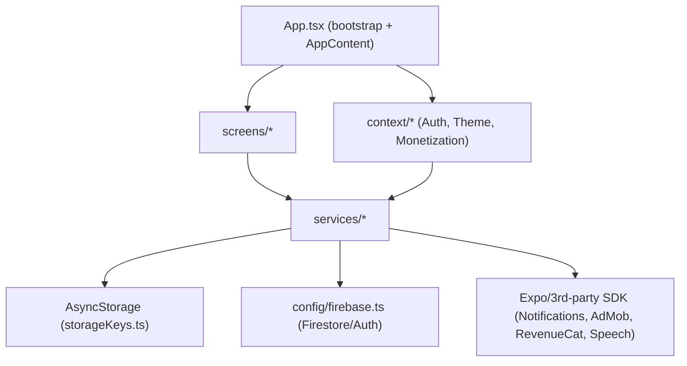

# 01 — Mevcut Mimari Audit'i

## Mevcut Durum

VocBee, kök dizine yayılmış **katmansız (flat) klasör** yapısına sahip bir Expo uygulamasıdır.
Giriş noktası `package.json` → `main: expo/AppEntry.js` → kökte `App.tsx`.

### Kök yerleşim (gerçek)

```
App.tsx                  # bootstrap + AppContent + tüm navigation + lifecycle (486 satır)
screens/                 # 10 ekran, bazıları çok büyük
components/              # paylaşılan + ekran-özel karışık UI bileşenleri
services/                # domain servisleri + altyapı (storage, sync, firebase erişimi)
context/                 # ThemeContext, AuthContext, MonetizationContext
utils/                   # typography, rtl, profileAvatar, streakCelebration
types.ts                 # RootStackParamList + ortak tipler
constants.ts             # renkler, LANGUAGES, LEVELS, TTS map
locales/                 # 21 dil + index.ts
config/firebase.ts       # Firebase init
api/                     # Vercel serverless: deleteAccount.js, grammarProxy.js
proxy/grammar-worker.ts  # Cloudflare Worker (grammar proxy, alternatif)
functions/               # Firebase Functions (src/index.ts + derlenmiş lib/)
tests/firestoreRules.ts  # Firestore rules emulator testleri
firestore.rules
```

### Katman akışı (gerçek bağımlılıklar)



### Dosya büyüklükleri (gerçek satır sayıları)

| Dosya | Satır | Not |
|-------|------:|-----|
| `screens/SettingsScreen.tsx` | 2196 | 21 useState, 0 useCallback, 5 useEffect, kullanılmayan Firestore import'u |
| `screens/HomeScreen.tsx` | 2185 | 17 useState, 20 useCallback, 10 useEffect, 11 AsyncStorage çağrısı |
| `screens/SetupScreens.tsx` | 1179 | setup adımları + bildirim izni + doğrudan Firestore yazımı |
| `services/notificationService.ts` | 1176 | scheduling + permission + tracking + içerik + streak reminder |
| `screens/AuthScreens.tsx` | 807 | Login + SignUp aynı dosyada |
| `screens/ExampleSentencesScreen.tsx` | 788 | TTS + grammar AI modal |
| `context/AuthContext.tsx` | 681 | auth + profile + notification settings + delete + retry |
| `services/adMobService.ts` | 509 | consent + ATT + interstitial + app-open + banner |
| `services/vocabularyService.ts` | 491 | asset map + merge + per-level storage + migration |
| `App.tsx` | 486 | bootstrap + AppContent (her şey tek dosyada) |

## Güçlü Yönler

1. **Storage key tek kaynaktan yönetiliyor.** `services/storageKeys.ts` tüm key'leri merkezîleştirir
   ve "değerleri değiştirme" uyarısı içerir. Bu, migration güvenliği için sağlam bir temel.
2. **Domain servisleri zaten ayrışmış.** `progressService`, `streakService`, `favoritesService`,
   `vocabularyService`, `notificationService` mantıksal olarak ayrı dosyalarda. Streak mantığı
   (`streakService.ts`) saf fonksiyonlarla (normalize/derive/canonical) yazılmış ve test edilmiş.
3. **Schema versiyonlama mevcut.** `vocabularyService` (`VOCABULARY_SCHEMA_VERSION = 2`) ve
   `notificationService` (`NOTIFICATION_CONTENT_VERSION = 4`) içerik/şema sürümleme yapıyor.
4. **Firestore rules güçlü ve tipli.** `firestore.rules` her alanı doğrular (`validPreferences`,
   `validProgress`, `validStreak`, `validNotificationSettings`, `validSyncMeta`).
5. **Anlamlı test tabanı var.** 21 Jest test dosyası (`services/__tests__`, `components/__tests__`,
   `screens/__tests__`, `utils/__tests__`) + Firestore rules emulator testi (`tests/firestoreRules.ts`).
6. **Sync güvenliği düşünülmüş.** `SyncService` retry+backoff, device-id ile çoklu cihaz çakışma
   tespiti, `needsSync` ile "unsynced local changes" koruması içeriyor.
7. **SDK izolasyonu kısmen var.** `adMobService` native modülü lazy `require` ile yüklüyor ve Expo Go'da
   güvenli düşüyor; `revenueCatService` prod/test key doğrulaması yapıyor.

## Sorunlar

1. **Dev (god) ekranlar.** `HomeScreen` (2185) ve `SettingsScreen` (2196) UI + state + iş mantığı +
   yan etkileri (TTS, ads, sync, Firestore yazımı) tek dosyada topluyor. Test edilemez ve değişiklik riski yüksek.
2. **`App.tsx` çok fazla sorumluluk taşıyor.** Bootstrap (font yükleme), provider zinciri, **tüm**
   navigation tanımı ve notification/ads/sync **lifecycle orkestrasyonu** (8+ useEffect) tek dosyada.
3. **Hook katmanı yok.** Ekranlar servisleri doğrudan çağırıp 15-26 adet `useState` ile orkestra ediyor.
   Yeniden kullanılabilir davranış (ör. "kelime kartı yükleme", "streak yenileme") ekrana gömülü.
4. **`AuthContext` aşırı yüklü.** Auth'a ek olarak profile cache, notification settings state'i,
   delete-account HTTP akışı ve retry logic'i de barındırıyor (681 satır).
5. **`notificationService` monolit.** Permission, scheduling, slot matematiği, tracked-notification
   işleme, içerik şablonları ve streak reminder tek dosyada (1176 satır).
6. **Doğrudan Firestore erişimi hâlâ UI/domain sınırlarında sızıntı yapıyor.** `SetupScreens.tsx`
   setup payload'ını doğrudan `setDoc` ile yazıyor; `SettingsScreen.tsx` içinde kullanılmayan
   `doc/setDoc` ve `db/auth` import'ları kalmış. `favoritesService` ve `SyncService` de Firestore'a
   doğrudan erişiyor; bu erişim refactorda `shared/firebase/userDoc.ts` sözleşmesine taşınmalı.
7. **Responsive yardımcılar kopyalanmış.** `scale`/`moderateScale` en az `HomeScreen`, `SettingsScreen`,
   `SetupScreens`, `ExampleSentencesScreen` ve bazı shared component'lerde ayrı ayrı tanımlı (DRY ihlali).
8. **`components/` karışık.** Gerçek paylaşılan tasarım sistemi (`UIComponents.tsx`: Button/Input/Header)
   ile ekran-özel parçalar (`HomeHeader`, `HomeTutorialOverlay`, `StreakCelebrationOverlay`) aynı seviyede.
9. **Stil tanımları satır içi ve tekrarlı.** Her büyük ekranın kendi `StyleSheet.create`'i var; tema
   renkleri `constants.ts`'ten geliyor ama tipografi/spacing token'ı yok.
10. **`@/*` alias az kullanılıyor.** `tsconfig.json` `@/*` -> `./*` tanımlı; kodda göreli importlar baskın.
11. **Bazı yardımcı servisler plana tam dahil değil.** `groqService`, `reviewPromptService`,
    `adMobService.web.ts`, `nativeGoogleSignIn`, `googleAuthConfig`, `socialAuthProfile`,
    `AppRatingPrompt` ve `ConnectionErrorScreen` refactor mapping'inde açık sahiplik bekliyor.
12. **Firestore notification settings sözleşmesi kırılgan.** `firestore.rules` tam
    `notificationSettings` alan seti beklerken Setup izin reddinde `{ enabled: false }` yazıyor.
    Refactor başlamadan önce bu davranış karakterize edilmeli ve `userDoc` kapısında normalize edilmelidir.

## Önerilen Yaklaşım

Detaylar `02-hedef-mimari.md`'de. Özet: **feature-based (domain) + ince katmanlı hibrit** yapıya,
`src/` kökü altında, **kademeli** geçiş. Servis katmanı zaten iyi durumda olduğu için önce **bootstrap
ayrıştırması** ve **dev ekranların parçalanması** önceliklendirilir.

## Alternatifler ve Neden Elendiler

- **Tek seferlik büyük rewrite** — Elendi: kullanıcı verisi/davranış koruma şartıyla ve canlı
  uygulamayla uyumsuz; risk çok yüksek.
- **Hiç dokunmama / sadece lint** — Elendi: dev ekranlar büyümeyi engelliyor; problem yapısal.
- **Sadece katmanlı (layered) yeniden düzenleme** — Elendi: ekranların iç karmaşasını çözmez (bkz. `02`).

## Riskler

- Büyük ekranlar parçalanırken davranış kayması (özellikle `HomeScreen`'deki animasyon/notification
  tüketim akışı). Azaltım: önce karakterizasyon testleri (bkz. `14`).
- `App.tsx` lifecycle sırasının değişmesi notification/ads zamanlamasını bozabilir (bkz. `03`).

## Test ve Kabul Kriterleri

- Audit, kod değiştirmediği için doğrulama: `npm run typecheck` ve `npm run test:ci` mevcut hâliyle yeşil olmalı (baseline).
- Bu doküman, sonraki tüm PR'ların referans aldığı "mevcut davranış" tanımıdır.

## Etkilenecek Dosyalar

Bu doküman salt analizdir; dosya değişikliği yok. Hedef yapı eşlemesi için bkz. `02-hedef-mimari.md`.
